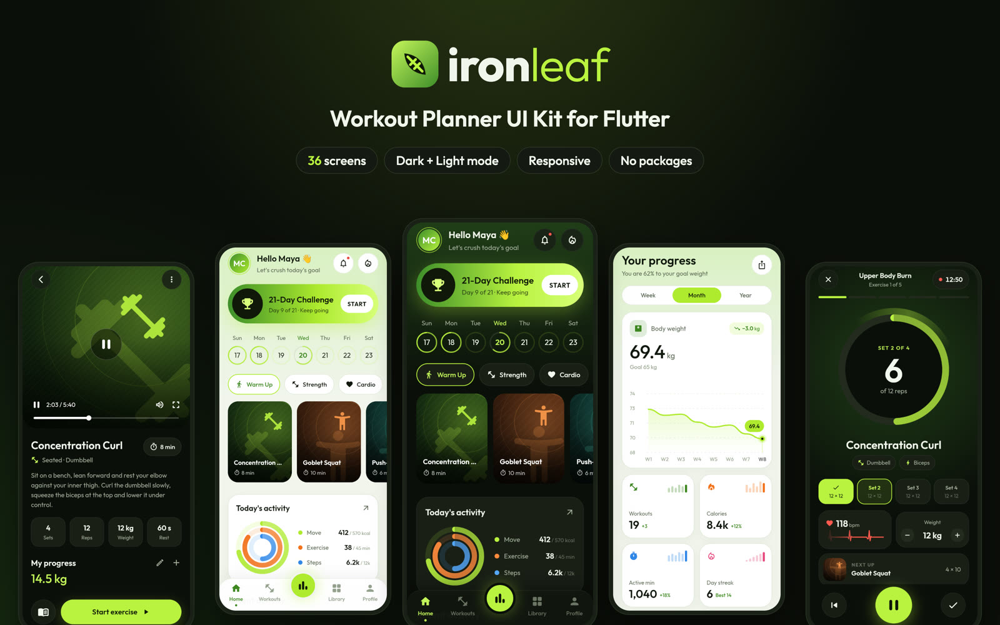

# Ironleaf – Workout Planner UI Kit for Flutter

A workout planner UI kit made with Flutter: 36 connected screens, dark and light modes and responsive layouts for phones, tablets and the web.

**▶ Try the live demo:** https://yaqoobdeveloper.github.io/Ironleaf-Workout-Planner-UI-Kit-in-Flutter/

**Get the full source code:** https://yaqoobdeveloper.com/ui-kits/ironleaf-workout-planner-flutter-ui-kit

## Highlights

- 36 screens: onboarding, setup quiz, home, workouts, exercise library, progress and profile
- 3 premium screens: Home Dashboard, Active Workout and Progress Dashboard
- Dark and light modes, switchable in the app
- Charts, activity rings and timers drawn in Flutter, with no chart packages
- No stock photos: artwork drawn in code
- Android, iOS and web from one codebase

This repository holds the live demo only. The Flutter source code is available on yaqoobdeveloper.com.
